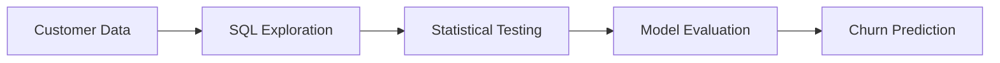

# 🏦 Bank Churn Analysis & Predictive Modeling

**Understanding customer churn through SQL, statistical testing, and machine learning.**

This project explores customer churn using data analysis, statistical hypothesis testing, and predictive modeling. It combines exploratory SQL queries with machine learning experiments to investigate churn patterns and identify customers who may be at risk of leaving.

---

## 🎯 The Business Problem

**How can customer data help a bank understand churn and identify customers who may leave?**

The project approaches this problem through three stages: exploring customer data, investigating relationships through statistical testing, and evaluating machine learning models for churn prediction.

## 📊 Project Results

| Metric | Result |
|---|---:|
| Customer records analyzed | 10,000 |
| Machine learning models evaluated | 5 |
| Highest recall achieved | **70%** |
| Model with highest recall | **SVM (RBF Kernel)** |

### Key Finding

The **Support Vector Machine (RBF Kernel)** achieved the highest recall at **70%** among the models evaluated.

Recall measures the proportion of actual churn cases correctly identified by a model. A recall of 70% means the model identified approximately 70% of actual churners in the evaluated dataset.

---

## 🔎 The Analytical Journey

## 🧩 What the Project Covers

<table>
  <tr>
    <td width="33%" valign="top">
      <h3>🔍 Explore</h3>
      Investigate customer churn patterns using SQL queries.
        <code>eda_queries/</code>
    </td>
    <td width="33%" valign="top">
      <h3>🧪 Test</h3>
      Examine relationships in the data using statistical hypothesis-testing notebooks.
        <code>notebook/statistical_testing/</code>
    </td>
    <td width="33%" valign="top">
      <h3>🤖 Predict</h3>
      Evaluate five machine learning models and compare their performance.
        <code>predictive_modelling/</code>
    </td>
  </tr>
</table>

## 🤖 Models Evaluated

- Logistic Regression
- Support Vector Machine (Polynomial Kernel)
- Support Vector Machine (RBF Kernel)
- Random Forest
- XGBoost

The SVM with an RBF kernel achieved the highest reported recall in the experiments. The available results do not establish that it was the best model across every evaluation metric.

## 🛠️ Technology Stack

`Python` · `SQL` · `pandas` · `NumPy` · `Matplotlib` · `Seaborn` · `scikit-learn` · `XGBoost` · `Jupyter`

## 📁 Project Structure

| Directory / File | Purpose |
|---|---|
| `data/` | Project data files |
| `eda_queries/` | SQL exploration queries |
| `notebook/statistical_testing/` | Statistical testing notebooks |
| `predictive_modelling/` | Machine learning experiments |
| `scripts/` | Supporting Python scripts |
| `requirements.txt` | Python dependencies |

## 💡 Takeaway

Customer churn analysis connects data exploration with predictive modeling. In this project, five models were evaluated, and the SVM with an RBF kernel achieved 70% recall, demonstrating its ability to identify a portion of the customers who actually churned in the evaluated dataset.

## 📄 License

This project is available under the [MIT License](LICENSE).
